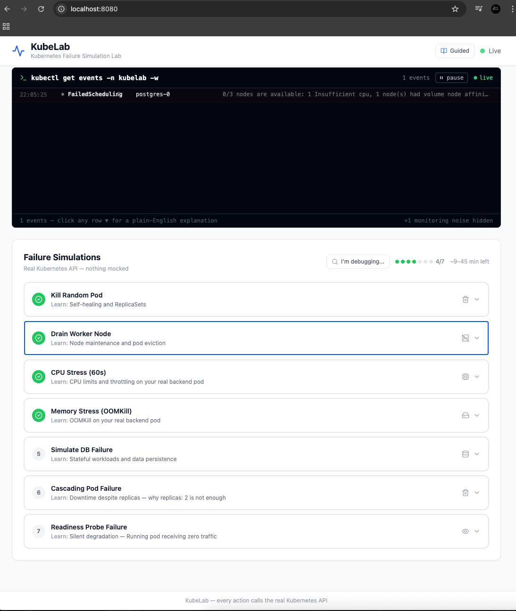

# KubeLab

[](https://github.com/Osomudeya/kubelab/stargazers) [](https://github.com/Osomudeya/kubelab/network) [](https://github.com/Osomudeya/kubelab/releases)

Break Kubernetes on purpose. Watch it self-heal.

**Everything you need to learn this repo is free and in GitHub** — README, [cluster setup](setup/k8s-cluster-setup.md), [simulation docs](docs/failure-scenarios.md), [architecture](docs/architecture.md), and the in-app guides. You do **not** need to buy a video or course to understand or run KubeLab. Optional paid resources are [at the bottom](#optional-paid-resources-not-required).

**New to Kubernetes?** Follow the path below — sequential simulations with explanations and quizzes (~90 minutes).

**Running Kubernetes in production?** Jump to [Debugging Production Issues](#debugging-production-issues) or use Explore mode in the UI (toggle in the header).

**Typical path:** [cluster setup](setup/k8s-cluster-setup.md) → `./scripts/deploy-all.sh` → [port-forward](#port-forwarding) → run [simulations](#simulations) in order → open each sim’s doc → [interview prep](docs/interview-prep.md).

---

## Quick start for new users (MicroK8s + Multipass)

1. **Prereqs on your laptop:** [Multipass](https://multipass.run) + [`kubectl`](https://kubernetes.io/docs/tasks/tools/) — see [What You Need](#what-you-need).
2. **Create the control-plane VM** and walk through **Parts 1–4** of [setup/k8s-cluster-setup.md](setup/k8s-cluster-setup.md) (VMs, MicroK8s on the control plane, workers/join, kubeconfig on your laptop). That guide is the full copy-paste path.
3. **MicroK8s on the control plane** — You need a working MicroK8s cluster and **kubeconfig on your laptop** ([Part 3](setup/k8s-cluster-setup.md#part-3--configure-kubectl-on-your-host)). How you get there is flexible:
   - **Script (optional):** run `./scripts/setup-cluster.sh` **on Linux** — e.g. `multipass shell microk8s-vm`, `cd` to this repo if you copied it into the VM, then run the script; or use `multipass exec microk8s-vm -- bash -lc 'cd /path/to/kube-lab && ./scripts/setup-cluster.sh'`. It installs/configures MicroK8s + addons. **Do not** run that script on the macOS/Windows host (snap is Linux-only).
   - **Already have MicroK8s?** Skip the script if the VM already has MicroK8s (e.g. you installed it manually). You still need kubeconfig on the host — from your normal terminal: `multipass exec microk8s-vm -- microk8s config > ~/.kube/microk8s.yaml` (use `sudo microk8s config` inside the exec if your user needs it), then merge into `~/.kube/config` and `kubectl config use-context microk8s` — [Part 3](setup/k8s-cluster-setup.md#part-3--configure-kubectl-on-your-host). No interactive `multipass shell` required.
4. **Deploy from the repo on your laptop** — `./scripts/deploy-all.sh` (requires `kubectl get nodes` to work first).
5. **Optional — add worker VMs from your laptop:** `./scripts/provision-worker-vms.sh` (skip if you already joined workers manually).
6. **Verify:** `kubectl get pods -n kubelab` → **11** pods **Running** (give it a few minutes). Then [open the UI with port-forward](#port-forwarding).

**No Kubernetes cluster yet?** [Docker Compose preview](setup/docker-compose-preview.md) (~5 min) — full UI, mock data only.

## What You Need

- **macOS, Linux, or Windows** with **8GB free RAM minimum, 12GB recommended** (3 VMs × 4GB each for full cluster)
- [Multipass](https://multipass.run) — install for [macOS](https://multipass.run/docs/installing-on-macos) · [Linux](https://multipass.run/docs/installing-on-linux) · [Windows](https://multipass.run/docs/installing-on-windows)
- `kubectl` — [install](https://kubernetes.io/docs/tasks/tools/) (e.g. macOS: `brew install kubectl`; Linux: `snap install kubectl --classic` or package manager; Windows: `winget install Kubernetes.kubectl` or Chocolatey)
- Docker only if building your own images (prebuilt `veeno/kubelab-*` images are public; no Docker Hub account needed)
- ~30 minutes

**Can't run 3 VMs right now?** → [5-minute Docker Compose preview](setup/docker-compose-preview.md). See the full UI with mock data. Simulations return fake responses — no real cluster, no real self-healing — but you can explore every screen and read all the content. Set up a real cluster when you're ready for the actual experience.

## Quick Start

### The two scripts (cheat sheet)

Full steps: [Quick start for new users](#quick-start-for-new-users-microk8s--multipass) at the top of this README. The **minimum** automation once the control-plane VM exists and `kubectl` points at MicroK8s:

| Order | Run where | What |
|------|-----------|------|
| **1** | **Control plane VM (Linux only)** — `multipass shell microk8s-vm` and/or `multipass exec microk8s-vm -- …` | **Optional:** `./scripts/setup-cluster.sh` — installs MicroK8s (snap) + addons if you don’t already have them. **Skip** if MicroK8s is already installed and working. **Never** run this script on the macOS/Windows host. |
| **2** | **Your laptop** | `./scripts/deploy-all.sh` after [kubeconfig works](setup/k8s-cluster-setup.md#part-3--configure-kubectl-on-your-host). Getting kubeconfig does **not** require an interactive VM shell — e.g. `multipass exec microk8s-vm -- microk8s config > ~/.kube/microk8s.yaml` then merge/use context `microk8s`. |

**Optional (host):** `./scripts/provision-worker-vms.sh` — creates/joins worker VMs to `microk8s-vm`. Default: three workers; `WORKER_VMS="kubelab-worker-1 kubelab-worker-2"` for two.

**All scripts explained:** [docs/scripts.md](docs/scripts.md) — what to run for a normal lab vs optional helpers (do not delete scripts from the repo).

**Already cloned and cluster-ready?**

```bash
./scripts/deploy-all.sh
kubectl get pods -n kubelab   # expect 11 Running (see Troubleshooting in README if Pending >3 min)
```

### Port forwarding

Services are **ClusterIP** by default — your browser cannot reach them until you port-forward (or use NodePort). More detail: [setup guide — Part 9](setup/k8s-cluster-setup.md#part-9--open-the-kubelab-ui-grafana-and-prometheus-side-by-side).

| Service | Command (one terminal each, or run in background) | URL |
|---------|---------------------------------------------------|-----|
| **Frontend** | `kubectl port-forward -n kubelab svc/frontend 8080:80` | http://localhost:8080 |
| **Grafana** | `kubectl port-forward -n kubelab svc/grafana 3000:3000` | http://localhost:3000 (`admin` / `kubelab-grafana-2026`) |
| **Prometheus** | `kubectl port-forward -n kubelab svc/prometheus 9090:9090` | http://localhost:9090 |

**Watch out for**

- **Wrong cluster** — `kubectl config current-context` should be your MicroK8s context (often `microk8s`) before port-forward or deploy. See [Watch Out For](#watch-out-for).
- **Port already in use** — change the first number: e.g. `8081:80` for frontend → open http://localhost:8081
- **Forwarding stops when the terminal closes** — use a second terminal, `tmux`/`screen`, or append `&` and disown if you know how.
- **404 in the browser** — usually no port-forward or wrong port; see [Troubleshooting — Frontend 404](#troubleshooting).
- **Grafana empty / “No data”** — wait 2–3 minutes after deploy; confirm Prometheus pod is Running; see [setup — Grafana](setup/k8s-cluster-setup.md#part-10--what-you-see-in-grafana) and [Troubleshooting](#troubleshooting).

**Alternative — NodePort (no port-forward):** `http://<node-ip>:30080` (frontend), `http://<node-ip>:30300` (Grafana). Prometheus stays ClusterIP-only — still use port-forward.

**While you simulate:** keep **UI + Grafana** open side by side. [Which Grafana panels map to which simulation →](docs/observability.md) · [Grafana dashboards in repo](k8s/observability/dashboards/README.md)

---

Check: `kubectl get pods -n kubelab` → **11 Running**:



| Component | Pods |
|-----------|------|
| frontend | 1 |
| backend | 2 |
| postgres | 1 |
| prometheus | 1 |
| grafana | 1 |
| kube-state-metrics | 1 |
| node-exporter | 1 per node (2–3) |

## Simulations

Run in this order in the UI — each builds on the previous. **After you run one, open the linked doc** to go deeper (commands, what to watch, production insight).

1. [Kill Pod](docs/simulations/pod-kill.md) — Self-healing, ReplicaSets
2. [Drain Node](docs/simulations/node-drain.md) — Zero-downtime maintenance
3. [CPU Stress](docs/simulations/cpu-stress.md) — Silent throttling
4. [OOMKill](docs/simulations/oomkill.md) — Memory limits, exit code 137
5. [DB Failure](docs/simulations/database.md) — StatefulSet persistence
6. [Cascading Failure](docs/simulations/cascading.md) — When replicas aren't enough
7. [Readiness Probe](docs/simulations/readiness.md) — Running but receiving zero traffic

All 7 are in the dashboard. Each linked doc has the exact kubectl commands and what to look for.

After the simulations: [Interview Prep](docs/interview-prep.md) — 10 questions this lab prepares you to answer.

## Debugging Production Issues

If you're here because something is broken in production — not to learn Kubernetes from scratch — start here:

**[Symptom → Simulation guide →](docs/diagnose.md)**

Maps what you're seeing in prod (exit code 137, high latency, 503 on some requests) to the simulation that reproduces it, with exact kubectl commands to diagnose your actual cluster.

Or use the **I'm debugging...** button in the UI to jump directly to the relevant simulation.

## Monitoring

Open Grafana and (optionally) Prometheus **next to the KubeLab UI** so you can trigger simulations in one window and watch metrics in the other. Grafana: `kubectl port-forward -n kubelab svc/grafana 3000:3000` → http://localhost:3000 (login: `admin` / `kubelab-grafana-2026`). Prometheus: `kubectl port-forward -n kubelab svc/prometheus 9090:9090` → http://localhost:9090. Dashboard and data source are auto-provisioned in Grafana.

[Which panels to watch during each simulation →](docs/observability.md)

## Watch Out For

**Join tokens expire in 60 seconds.** Run `microk8s add-node` immediately before each worker joins — not 2 minutes earlier. If it fails with `connection refused`, just generate a new token.

**kubeconfig context matters.** If you have EKS or GKE configured: `kubectl config use-context microk8s` before deploying or you'll be deploying to the wrong cluster.

**Both backend pods on the same node?** `kubectl get pods -n kubelab -o wide | grep backend` — if they're on the same node, draining it takes down both replicas simultaneously. Expected — it's a lab, not production.

## Troubleshooting

**Pods Pending?** `kubectl describe pod -n kubelab <name>` → read the Events section

**Frontend 404?** Use port-forward: `kubectl port-forward -n kubelab svc/frontend 8080:80` then open http://localhost:8080. Or check NodePort: `kubectl get svc -n kubelab frontend` (30080)

**Backend errors?** `kubectl logs -n kubelab -l app=backend`

**Grafana no data?** `kubectl get pods -n kubelab` — confirm prometheus and grafana are Running

**Simulations fail (403)?**
```bash
kubectl auth can-i delete pods --as=system:serviceaccount:kubelab:kubelab-backend-sa -n kubelab
# If "no": kubectl apply -f k8s/security/rbac.yaml
```

**Clean start?** `kubectl delete namespace kubelab` then re-run the deploy commands above (or `./scripts/deploy-all.sh`).

**Build-and-push script hangs?** It is waiting for "Push images? (y/N)". Use `./scripts/build-and-push.sh <username> latest -y` to skip the prompt. See [docker-setup.md](setup/docker-setup.md#troubleshooting).

## Documentation

| Topic | Link |
|-------|------|
| **Scripts — what to use vs ignore** | [docs/scripts.md](docs/scripts.md) |
| MicroK8s cluster (VMs, join, kubeconfig) | [setup/k8s-cluster-setup.md](setup/k8s-cluster-setup.md) |
| Docker / Compose preview (no cluster) | [setup/docker-compose-preview.md](setup/docker-compose-preview.md) |
| Build & push images | [setup/docker-setup.md](setup/docker-setup.md) |
| All failure scenarios (overview) | [docs/failure-scenarios.md](docs/failure-scenarios.md) |
| Grafana panels × simulation | [docs/observability.md](docs/observability.md) |
| Prod symptom → which sim | [docs/diagnose.md](docs/diagnose.md) |
| Architecture | [docs/architecture.md](docs/architecture.md) |
| Interview prep (after sims) | [docs/interview-prep.md](docs/interview-prep.md) |

## Optional paid resources (not required)

These are **optional** paid guides from the same author. **They are not required** to use KubeLab — all learning paths and commands are in this repo and the docs above.

| Resource | What it is |
|----------|------------|
| **[The Kubernetes Detective — troubleshooting demo](https://osomudeya.gumroad.com/l/jabzk)** | Deeper guided troubleshooting narrative (not a prerequisite for the repo). |
| **[DevOps Operating System](https://osomudeya.gumroad.com/l/devops-atlas)** | Broader curriculum (Linux, Git, Docker, K8s, tickets). **KubeLab is not gated behind this.** |
